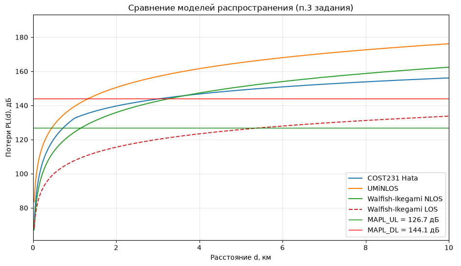
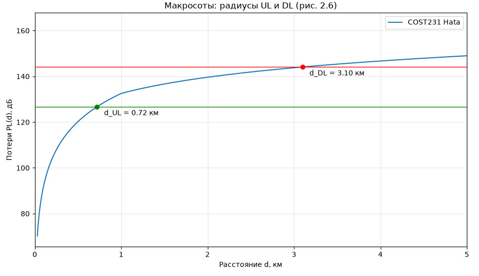
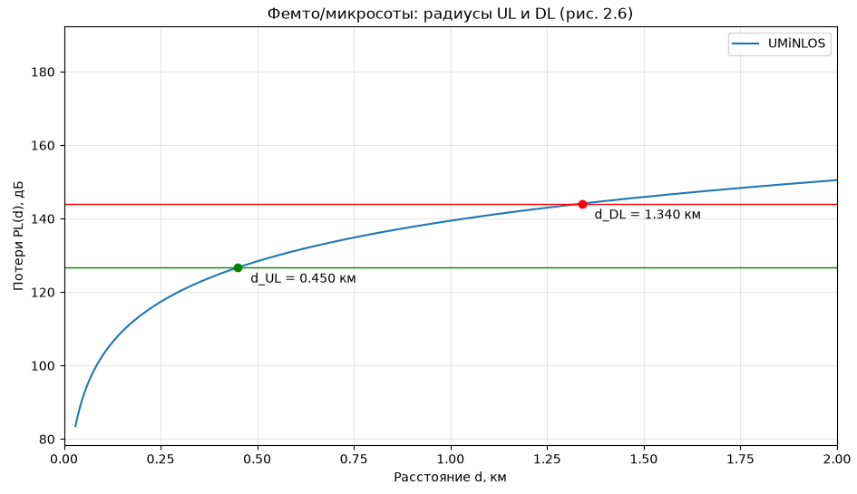

# Основы систем мобильной связи (ОСМС)
### Лабораторный практикум, 2026

> **Сибирский государственный университет телекоммуникаций и информатики (СибГУТИ)**  
> Специальность: Программное обеспечение систем мобильной связи  
> Дисциплина: Основы систем мобильной связи (ОСМС)  
> Преподаватель: Дроздова В. Г.  
> Студент: Шеин К. Е., группа ИКС-431

<p align="center">
  
  <br>
</p>

[](https://python.org)
[](https://numpy.org)
[](https://scipy.org)
[](./LICENSE)

---

<details>
<summary><h2 style="display: inline;">📈Лабораторная работа 1. Временная и частотная формы сигналов. Преобразования Фурье. Дискретизация сигналов</h2></summary> 

## **Вариант:** 25  

## Цель работы

Получить представление о формах радиосигналов, их временном и частотном представлении, преобразованиях Фурье и процедуре аналого-цифрового преобразования (АЦП). На практике изучить влияние частоты дискретизации и разрядности АЦП на спектр и качество восстановленного сигнала.


## Теоретическая справка

### Теорема Котельникова

Непрерывный сигнал с ограниченным спектром можно точно восстановить по его дискретным отсчётам, если частота дискретизации $f_s$ превышает максимальную частоту в спектре сигнала $f_{\max}$ минимум в два раза:

$$
f_s > 2 \cdot f_{\max}
$$

### Дискретное преобразование Фурье (ДПФ)

Переход от временного представления сигнала к частотному осуществляется через прямое ДПФ:

$$
F(x) = \sum_{n=0}^{N-1} f(n) \cdot e^{-j 2\pi \frac{x \cdot n}{N}}
$$

где:

- $N$ — количество отсчётов,
- $f(n)$ — дискретный сигнал во временной области,
- $F(x)$ — спектр.

Сложность алгоритма: $O(N^2)$. Для ускорения используется **Быстрое преобразование Фурье (БПФ)** со сложностью $O(N \log N)$.

### Квантование по уровню

АЦП с разрядностью $B$ бит представляет сигнал конечным числом уровней $L = 2^B$. Шаг квантования:

$$
\Delta = \frac{A_{\max} - A_{\min}}{L}
$$

## Задание и ход выполнения

Исходный сигнал по **варианту 25**:

$$
y(t) = 4 \cos\left(2\pi \cdot 26 \cdot t + \frac{\pi}{12}\right)
$$

**Параметры:**

- Частота: $f = 26$ Гц
- Амплитуда: $A = 4$
- Максимальная частота в спектре: $f_{\max} = 26$ Гц
- Минимальная частота дискретизации по Котельникову: $f_s > 52$ Гц
- Выбранная частота: $f_s = 53$ Гц (минимально допустимая с запасом)


### Пункты 1–3. Непрерывный сигнал и теорема Котельникова

Сгенерирован и визуализирован «непрерывный» сигнал (имитация через мелкую сетку времени с 10 000 точек).

<p align="center">
  
  <br>
</p>


### Пункты 4–5. Дискретизация и ручной расчёт ДПФ

Сигнал оцифрован с частотой $f_s = 53$ Гц на интервале 1 секунда (53 отсчёта). Для полученного массива выполнено **прямое ДПФ вручную** по формуле из методички с использованием двойного цикла.

<p align="center">
  
  <br>
</p>

**Результат ДПФ:** спектр содержит две линии — на частотах **26 Гц** и **27 Гц** 

<p align="center">
  
  <br>
</p>


### Пункт 6. Восстановление сигнала при $f_s = 53$ Гц

Сравнение оригинального аналогового сигнала и восстановленного через линейную интерполяцию отсчётов.

<p align="center">
  
  <br>
</p>


### Пункт 7. Увеличение частоты дискретизации в 4 раза

Повторяем эксперимент с $f_s = 212$ Гц (212 отсчётов, ≈8 отсчётов на период).

<p align="center">
  
  <br>
</p>

<p align="center">
  
  <br>
</p>


### Пункты 8–10. Запись голоса и анализ в Audacity

Записан голосовой сигнал длительностью ~4.67 с. Параметры файла:

- Количество отсчётов: $N = 224\,256$
- Частота дискретизации: $F_s = 48\,000$ Гц
- Проверка: $N / T = 224\,256 / 4.67 \approx 48\,000$ Гц ✓

<p align="center">
  
  <br>
</p>


### Пункты 11–12. Прореживание и эффект алиасинга

Сигнал прорежен в 10 раз: новая частота $f_s' = 4800$ Гц. Это **грубо нарушает теорему Котельникова**, что приводит к алиасингу.

<p align="center">
  
  <br>
</p>

<p align="center">
  
  <br>
</p>

### Пункт 13. Влияние разрядности АЦП на спектр

Для сигнала варианта 25 смоделировано квантование по уровню с разрядностью **3, 4, 5 и 6 бит**.

| Разрядность, бит | Уровней ($L$) | Шаг квантования ($\Delta$) | Средняя ошибка |
|:---:|:---:|:---:|:---:|
| 3 | 8  | 1.000 | 0.33177 |
| 4 | 16 | 0.500 | 0.15377 |
| 5 | 32 | 0.250 | 0.07264 |
| 6 | 64 | 0.125 | 0.03483 |

<p align="center">
  
  <br>
</p>

## Используемые технологии

- **Python 3.12** с виртуальным окружением
- **NumPy** — операции с массивами, ДПФ, математика
- **SciPy** — расширенные функции ЦОС
- **Matplotlib** — визуализация сигналов и спектров
- **SoundFile / SoundDevice** — работа с аудиофайлами и воспроизведение
- **Audacity** — визуальный спектральный анализ голосового сигнала

## Запуск

```bash
git clone https://github.com/thausoma/osms.git
cd osms

python -m venv venv
source venv/bin/activate

pip install -r requirements.txt

python "transformations_Fourier_analysis_(lab1)/tasks1-8.py"
python "transformations_Fourier_analysis_(lab1)/tasks8-14.py"
```

</details>

<br>

<details>
<summary><h2 style="display: inline;">📲Лабораторная работа 2. Проектирование радиопокрытия мобильных сетей. Модели распространения сигналов. Бюджеты каналов</h2></summary>

## Цель работы

Получить представление о том, как проектируется покрытие сетей мобильной связи, и научиться рассчитывать радиус действия отдельных базовых станций и требуемое количество БС для заданной площади.

## Исходные данные

| Параметр | Значение |
|---|---|
| Мощность передатчика BS / UE | 46 дБм / 24 дБм |
| Число секторов на одной BS | 3 |
| Коэффициент усиления антенны BS | 21 дБи |
| Запас на проникновение сквозь стены / на интерференцию | 15 дБ / 1 дБ |
| Модель для макросот / для фемто- и микросот | COST231 Hata / UMiNLOS |
| Диапазон частот | 1.8 ГГц |
| Полоса частот UL / DL | 10 МГц / 20 МГц |
| Коэффициент шума приёмника BS / UE | 2.4 дБ / 6 дБ |
| Требуемое SINR DL / UL | 2 дБ / 4 дБ |
| Антенны MIMO на BS | 2 |
| Площадь территории / торговых и бизнес-центров | 100 кв. км / 4 кв. км |
| Конфигурация BS | с фидерами |

## Рабочие формулы

Чувствительность приёмника и тепловой шум:

$$RxSens = NoiseFigure + ThermalNoise + RequiredSINR$$
$$ThermalNoise = -174 + 10 \cdot \log_{10}(BW)$$

Бюджеты каналов (из равенства уровня сигнала на приёмнике и чувствительности):

$$TxPower_{BS} - FeederLoss + AntGain_{BS} + MIMOGain - MAPL_{DL} - IM - PenetrationM = RxSens_{UE}$$
$$TxPower_{UE} - FeederLoss + AntGain_{BS} + MIMOGain - MAPL_{UL} - IM - PenetrationM = RxSens_{BS}$$

Модели распространения: UMiNLOS (помещения, формула 2.3 методички), COST231 Hata (макросоты, формулы 2.4–2.7), Walfish-Ikegami (городская grid-застройка, формулы 2.8–2.16). Радиус соты находится как точка пересечения кривой PL(d) с уровнями MAPL_UL и MAPL_DL; в расчёт берётся меньший из двух радиусов. Площадь сайта из трёх секторов: $S = 1.95 \cdot R^2$.

## Ход выполнения

### 1. Бюджеты каналов и MAPL

Потери в антенно-фидерном тракте для БС с фидером приняты равными 2.9 дБ (фидер 2 дБ + МШУ 0.4 дБ + джампер 0.5 дБ), выигрыш MIMO 2x2 рассчитан как $10 \cdot \log_{10}(2) = 3.01$ дБ.

| Величина | UL | DL |
|---|:---:|:---:|
| ThermalNoise, дБм | -104.00 | -100.99 |
| RxSens, дБм | -97.60 (приёмник BS) | -92.99 (приёмник UE) |
| MAPL, дБ | 126.71 | 144.10 |

Бюджет DL больше за счёт мощности передатчика БС (46 дБм против 24 дБм у UE); частично это компенсируется лучшей чувствительностью приёмника БС.

### 2. Зависимости PL(d) по трём моделям

Построены кривые потерь для UMiNLOS, COST231 Hata и Walfish-Ikegami (LOS и NLOS) с уровнями MAPL. UMiNLOS растёт круче всех (помещение), Walfish-Ikegami LOS даёт наименьшие потери (прямая видимость). Согласно исходным данным для расчётов выбраны COST231 Hata (макросоты) и UMiNLOS (фемто- и микросоты).

<p align="center">
  
  <br>
</p>

### 3. Радиусы сот в UL и DL

Точки пересечения PL(d) с MAPL_UL и MAPL_DL дают радиусы направлений. В обоих сценариях d_UL меньше d_DL: восходящий канал слабее из-за малой мощности передатчика UE, поэтому именно он ограничивает зону действия соты.

Макросоты (COST231 Hata):

<p align="center">
  
  <br>
</p>

Фемто- и микросоты (UMiNLOS):

<p align="center">
  
  <br>
</p>

### 4. Площадь сайта и количество БС

По меньшему радиусу (UL) рассчитана площадь одного сайта и требуемое число БС для непрерывного покрытия.

## Результаты

| Сценарий | Модель | d_UL, км | d_DL, км | Радиус, км | Площадь сайта, кв. км | Число БС |
|---|---|:---:|:---:|:---:|:---:|:---:|
| Макросоты, 100 кв. км | COST231 Hata | 0.72 | 3.10 | 0.72 | 1.01 | 99 |
| Фемто- и микросоты, 4 кв. км | UMiNLOS | 0.450 | 1.340 | 0.450 | 0.395 | 11 |

Параметры, не заданные в исходных данных, приняты в пределах границ применимости COST231 Hata: высота подвеса антенны БС 50 м, высота антенны мобильного устройства 1.8 м, тип местности — город (urban).

## Выводы

Радиус соты в обоих сценариях ограничен восходящим каналом, что согласуется с примером методички: мощность передатчика UE существенно ниже мощности БС. Для непрерывного покрытия территории 100 кв. км макросотами требуется 99 сайтов, а для 4 кв. км торговых и бизнес-центров — 11 микро- и фемтосот. Эмпирические модели (COST231 Hata, UMiNLOS) дают значительно более консервативные оценки потерь, чем модель свободного пространства, поскольку учитывают застройку и препятствия.

## Запуск

```bash
python "radio_coverage_design_(lab2)/coverage.py"
```

</details>
