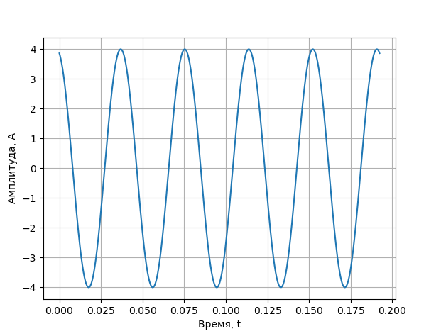
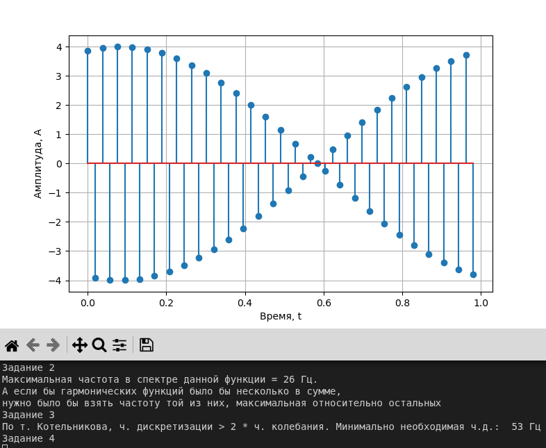
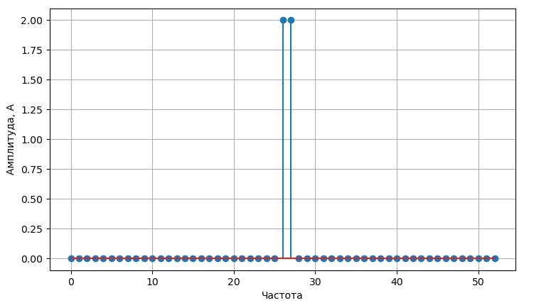
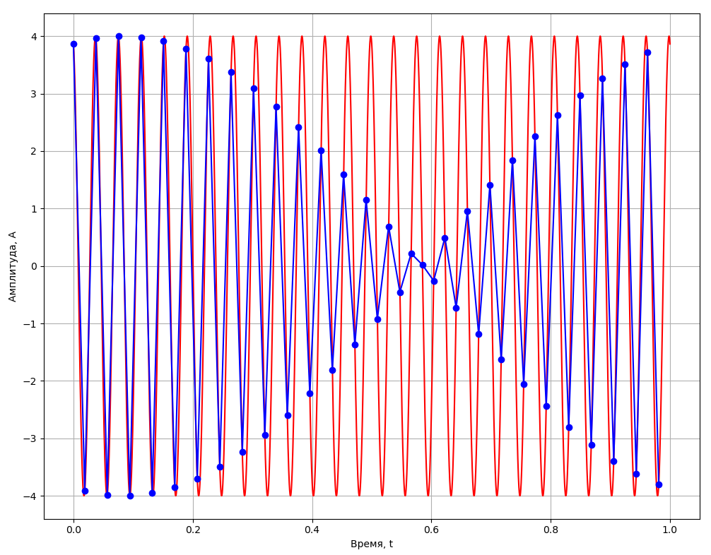
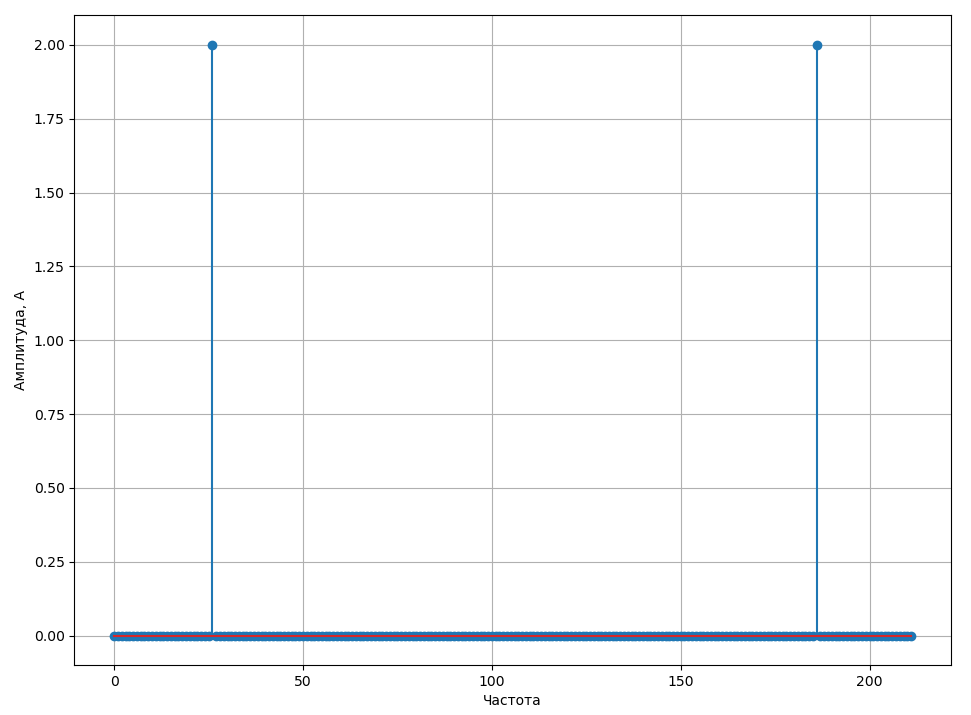
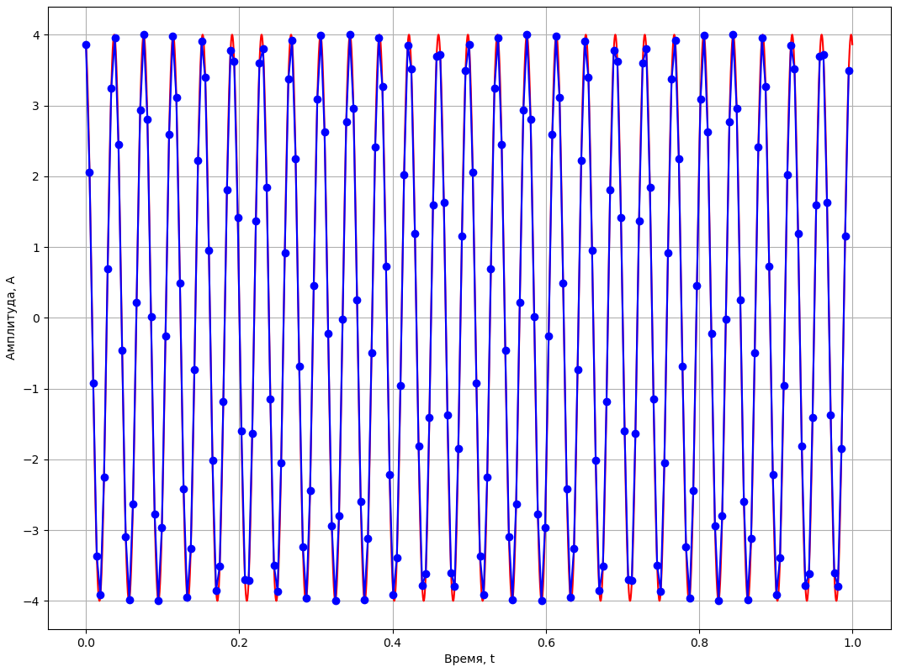
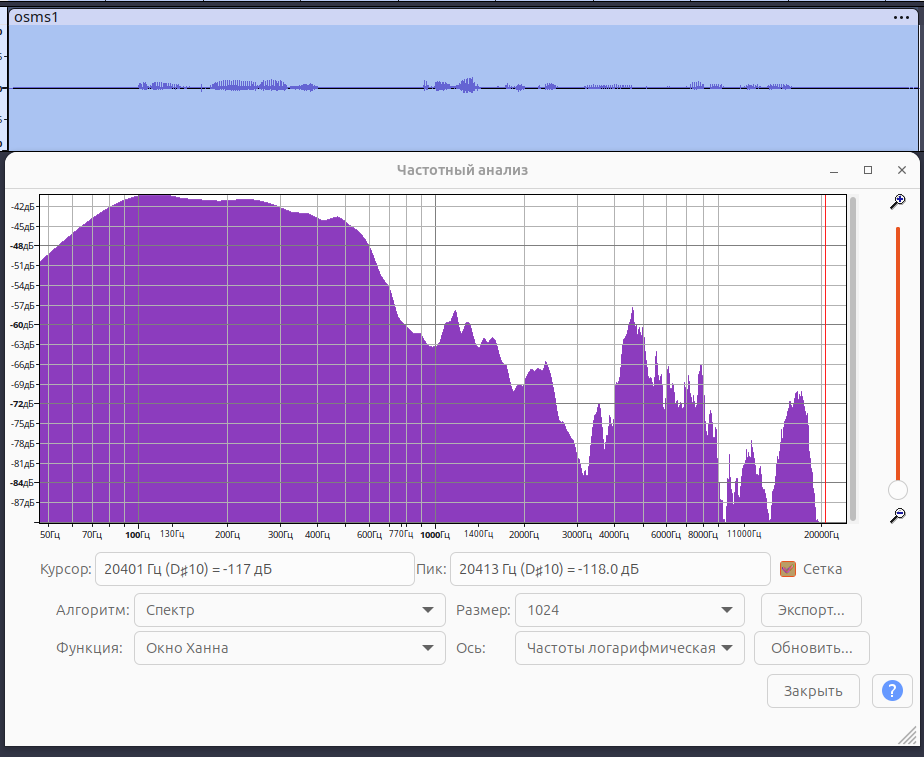
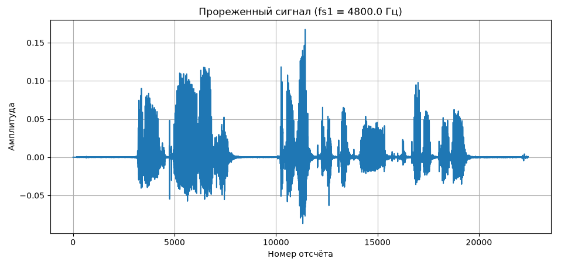
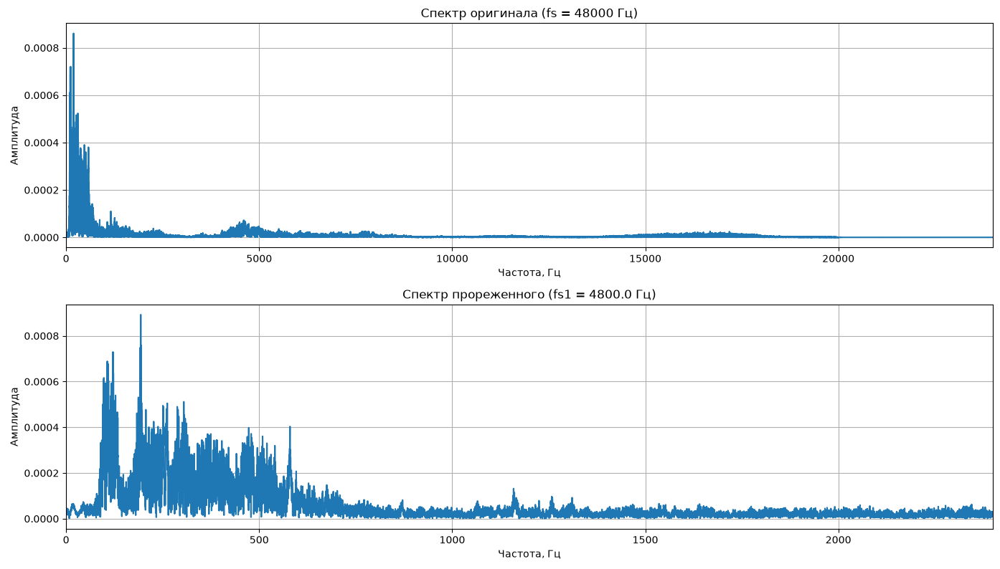
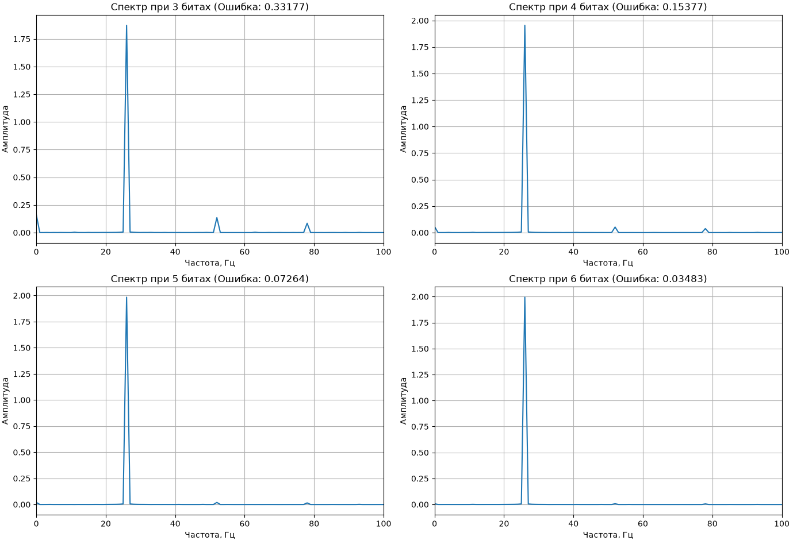

# Лабораторная работа №1
## Временная и частотная формы сигналов. Преобразования Фурье. Дискретизация сигналов

**Дисциплина:** Основы систем мобильной связи (ОСМС)  
**Преподаватель:** Дроздова В. Г.  
**Студент:** Шеин К. Е., ИКС-431
**Вариант:** 25  

[](https://python.org)
[](https://numpy.org)
[](https://scipy.org)
[](./LICENSE)

---

## Цель работы

Получить представление о формах радиосигналов, их временном и частотном представлении, преобразованиях Фурье и процедуре аналого-цифрового преобразования (АЦП). На практике изучить влияние частоты дискретизации и разрядности АЦП на спектр и качество восстановленного сигнала.

---

## Теоретическая справка

### Теорема Котельникова

Непрерывный сигнал с ограниченным спектром можно точно восстановить по его дискретным отсчётам, если частота дискретизации $f_s$ превышает максимальную частоту в спектре сигнала $f_{\max}$ минимум в два раза:

$$
f_s > 2 \cdot f_{\max}
$$

### Дискретное преобразование Фурье (ДПФ)

Переход от временного представления сигнала к частотному осуществляется через прямое ДПФ:

$$
F(x) = \sum_{n=0}^{N-1} f(n) \cdot e^{-j 2\pi \frac{x \cdot n}{N}}
$$

где:

- $N$ — количество отсчётов,
- $f(n)$ — дискретный сигнал во временной области,
- $F(x)$ — спектр.

Сложность алгоритма: $O(N^2)$. Для ускорения используется **Быстрое преобразование Фурье (БПФ)** со сложностью $O(N \log N)$.

### Квантование по уровню

АЦП с разрядностью $B$ бит представляет сигнал конечным числом уровней $L = 2^B$. Шаг квантования:

$$
\Delta = \frac{A_{\max} - A_{\min}}{L}
$$


## 🧪 Задание и ход выполнения

Исходный сигнал по **варианту 25**:

$$
y(t) = 4 \cos\left(2\pi \cdot 26 \cdot t + \frac{\pi}{12}\right)
$$

**Параметры:**

- Частота: $f = 26$ Гц
- Амплитуда: $A = 4$
- Максимальная частота в спектре: $f_{\max} = 26$ Гц
- Минимальная частота дискретизации по Котельникову: $f_s > 52$ Гц
- Выбранная частота: $f_s = 53$ Гц (минимально допустимая с запасом)

---

### Пункты 1–3. Непрерывный сигнал и теорема Котельникова

Сгенерирован и визуализирован «непрерывный» сигнал (имитация через мелкую сетку времени с 10 000 точек).

<p align="center">
  
  <br>
</p>

---

### Пункты 4–5. Дискретизация и ручной расчёт ДПФ

Сигнал оцифрован с частотой $f_s = 53$ Гц на интервале 1 секунда (53 отсчёта). Для полученного массива выполнено **прямое ДПФ вручную** по формуле из методички с использованием двойного цикла.

<p align="center">
  
  <br>
</p>

**Результат ДПФ:** спектр содержит две линии — на частотах **26 Гц** и **27 Гц** 

<p align="center">
  
  <br>
</p>

---

### Пункт 6. Восстановление сигнала при $f_s = 53$ Гц

Сравнение оригинального аналогового сигнала и восстановленного через линейную интерполяцию отсчётов.

<p align="center">
  
  <br>
</p>

---

### Пункт 7. Увеличение частоты дискретизации в 4 раза

Повторяем эксперимент с $f_s = 212$ Гц (212 отсчётов, ≈8 отсчётов на период).

<p align="center">
  
  <br>
</p>

<p align="center">
  
  <br>
</p>

---

###  Пункты 8–10. Запись голоса и анализ в Audacity

Записан голосовой сигнал длительностью ~4.67 с. Параметры файла:

- Количество отсчётов: $N = 224\,256$
- Частота дискретизации: $F_s = 48\,000$ Гц
- Проверка: $N / T = 224\,256 / 4.67 \approx 48\,000$ Гц ✓

<p align="center">
  
  <br>
</p>

---

### Пункты 11–12. Прореживание и эффект алиасинга

Сигнал прорежен в 10 раз: новая частота $f_s' = 4800$ Гц. Это **грубо нарушает теорему Котельникова**, что приводит к алиасингу.

<p align="center">
  
  <br>
</p>

<p align="center">
  
  <br>
</p>

---

### Пункт 13. Влияние разрядности АЦП на спектр

Для сигнала варианта 25 смоделировано квантование по уровню с разрядностью **3, 4, 5 и 6 бит**.

| Разрядность, бит | Уровней ($L$) | Шаг квантования ($\Delta$) | Средняя ошибка |
|:---:|:---:|:---:|:---:|
| 3 | 8  | 1.000 | 0.33177 |
| 4 | 16 | 0.500 | 0.15377 |
| 5 | 32 | 0.250 | 0.07264 |
| 6 | 64 | 0.125 | 0.03483 |

<p align="center">
  
  <br>
</p>

---

## Используемые технологии

- **Python 3.12** с виртуальным окружением
- **NumPy** — операции с массивами, ДПФ, математика
- **SciPy** — расширенные функции ЦОС
- **Matplotlib** — визуализация сигналов и спектров
- **SoundFile / SoundDevice** — работа с аудиофайлами и воспроизведение
- **Audacity** — визуальный спектральный анализ голосового сигнала

---

## Запуск

```bash
git clone https://github.com/thausoma/osms.git
cd osms

python -m venv venv
source venv/bin/activate

pip install -r requirements.txt

python src/tasks1-8.py
python src/tasks8-14.py